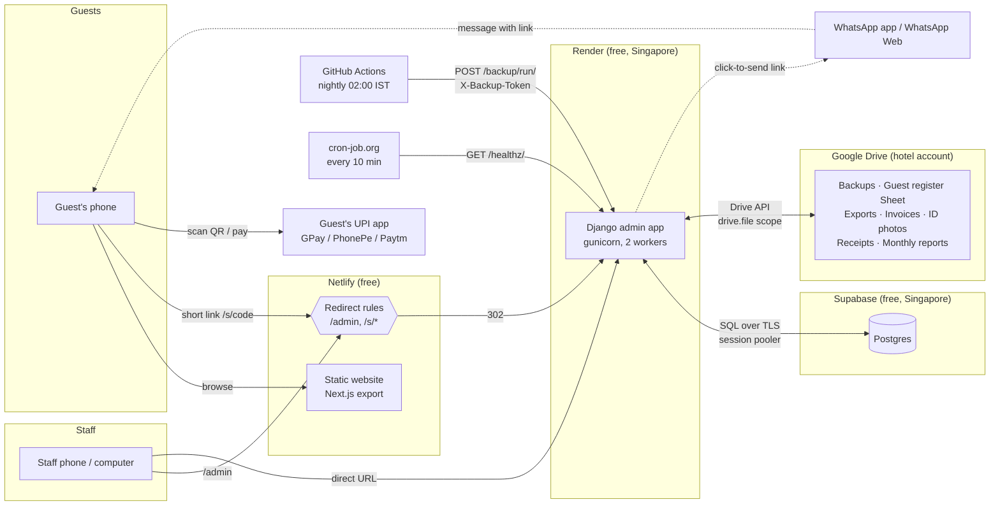
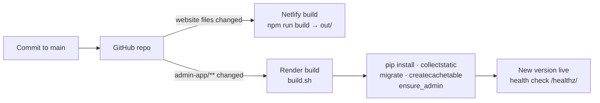
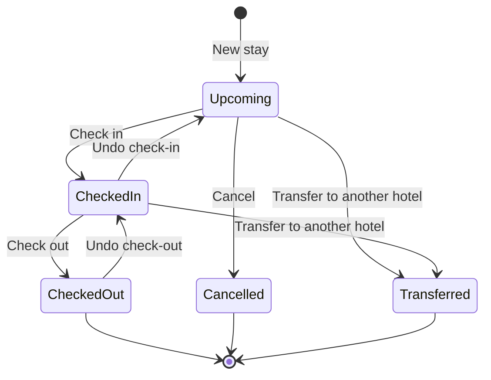
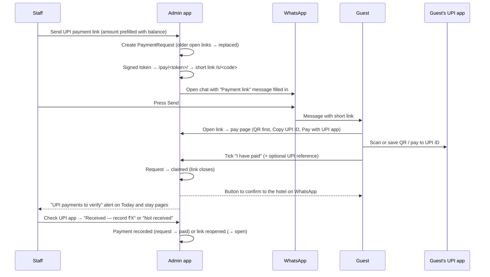
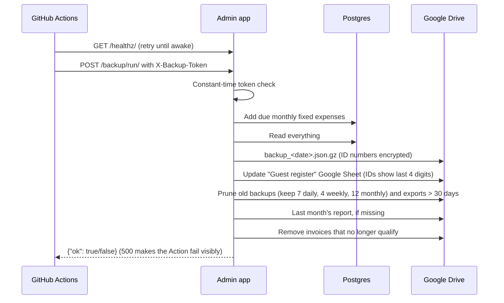
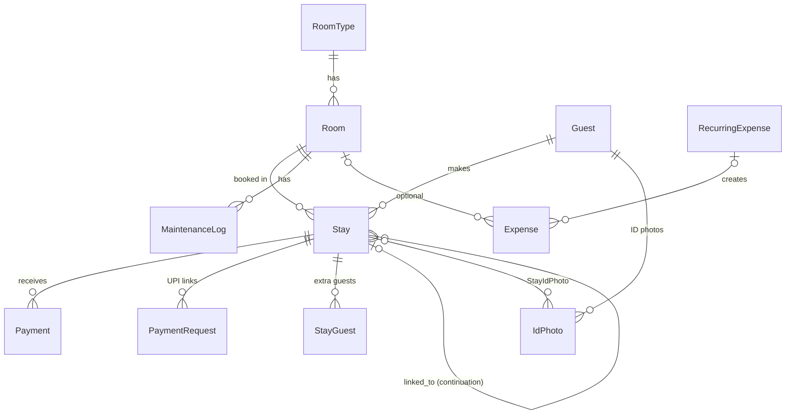

# BSR Corridors — System Design

Status: describes the system as built, November 2026. Functional requirements live in
[requirements.md](requirements.md); setup steps live in [admin-app/README.md](../admin-app/README.md).

---

## 1. What the system is

BSR Corridors is a small serviced-rooms property in Gachibowli, Hyderabad. The system has two parts:

| Part | What it does | Who uses it |
|---|---|---|
| **Public website** | Marketing site: rooms, amenities, gallery, location, house rules, contact via call or WhatsApp. | Prospective guests, search engines |
| **Admin app** | Private operations app: rooms, guests, stays, calendar, payments, invoices, UPI payment links, WhatsApp messages, expenses, revenue and profit sharing, backups. | Owner, partners and hosts (staff) |

The admin app also serves a few **public, signed pages** to guests: their invoice and their UPI payment page,
reached through short links on the website domain.

**Design goals**

1. **Zero running cost.** Everything runs on free tiers (Netlify, Render, Supabase, GitHub Actions, Google Drive).
2. **Phone first.** Staff work from a phone at the front desk; every page works at phone width.
3. **Data can't be lost or corrupted.** Double bookings are blocked by the database itself, every change is logged,
   and a full encrypted backup goes to Google Drive every night.
4. **Guest data is protected.** ID numbers are encrypted at rest and masked on screen; ID photos are stored
   stripped of location data; the app is never indexed by search engines.
5. **Simple to run.** One Django project, server-rendered pages, no separate frontend build for the admin app.

---

## 2. Architecture



### 2.1 Components

| Component | Technology | Hosting | Notes |
|---|---|---|---|
| Website | Next.js 16, React 19, TypeScript, static export (`output: "export"`) | Netlify | Content in `content/hotel.ts`. Rebuilds only when website files change. |
| Admin app | Django 5.2, Python, server-rendered templates, htmx for partial updates, plain JS (`static/js/app.js`) | Render web service, free plan, Singapore | `gunicorn config.wsgi --workers 2 --timeout 60`. Static files via WhiteNoise. |
| Database | PostgreSQL | Supabase, Singapore, session pooler (port 5432, IPv4), `sslmode=require` | SQLite is used locally and in tests when `DATABASE_URL` is not set. |
| Cache | Django database cache (`cache_table`) | Same Postgres | Holds login-throttle counters and revenue-unlock state. No Redis needed. |
| File storage | Google Drive API v3, OAuth refresh token, `drive.file` scope | Hotel's Google account | The app can only see files it created. |
| Scheduler | GitHub Actions cron (`.github/workflows/admin-backup.yml`) | GitHub | Wakes the app, then triggers the nightly job. |
| Keep-awake | cron-job.org pinging `/healthz/` every 10 minutes | External | Stops Render sleeping and Supabase pausing. |
| Messaging | WhatsApp click-to-send links (`whatsapp://send` on phones, `web.whatsapp.com/send` on computers) | None | No WhatsApp Business API, no Meta account, no cost. Staff press Send. |
| Payments | UPI deep links (`upi://pay?...`) and QR codes (segno) | None | No payment gateway, no fees. Money goes straight to the hotel's UPI ID. |
| Invoices | fpdf2 PDFs | Saved to Google Drive | |

### 2.2 How the website and the admin app connect

Netlify serves the website and forwards three paths to the admin app with 302 redirects (`netlify.toml`):

| Website path | Goes to | Purpose |
|---|---|---|
| `/admin`, `/admin/*` | `https://bsr-corridors-admin.onrender.com/...` | Staff sign-in |
| `/s/*` | `https://bsr-corridors-admin.onrender.com/s/...` | Short links sent to guests |

Short links therefore look like `https://bsrcorridors.netlify.app/s/Ab3dE9x`: short, on the hotel's own domain, and
they keep working if the Render address ever changes (only `netlify.toml` would need updating).

### 2.3 Deployment pipeline



- Both platforms auto-deploy from `main`.
- Netlify's `ignore` rule skips website builds when only `admin-app/`, `docs/` or the backup workflow changed.
  Render's `buildFilter` only rebuilds for changes under `admin-app/`.
- Database migrations run automatically on every Render deploy (`build.sh`). Data migrations (for example, adding
  a default WhatsApp message) are written as idempotent `RunPython` steps.
- Infrastructure is declared in `render.yaml` (Render Blueprint) and `netlify.toml`.

---

## 3. Main flows

### 3.1 Staff request

1. Staff open `/admin` on the website, which redirects to the Render app (or they open it directly).
2. `LoginRequiredMiddleware` sends anyone not signed in to `/login/`, except on the public paths
   (`/login/`, `/static/`, `/healthz/`, `/backup/run/`, `/invoice/`, `/pay/`, `/s/`).
3. `CurrentUserMiddleware` records who is signed in, so every audit-log entry names the person.
4. The view calls the business-rule layer (`core/services.py`), which runs inside a database transaction.
5. The page is rendered on the server. htmx swaps parts of the page where that saves a reload.

### 3.2 Booking life cycle



- **Quick future booking:** only name, room and dates are needed. Phone and address become required at check-in.
- **Daily stays** have a check-out date. **Monthly stays** are open-ended: the room stays blocked until a check-out
  date is set, rent is added month by month ("Add month's rent"), and a refundable security deposit is kept apart
  from payments.
- **Check in** opens the stay page with a welcome alert: *Send welcome message* and *Send caretaker contact*.
- **Check out** generates the invoice if one is due (with a loading overlay) and opens the departure message.

### 3.3 Guest payment by UPI link (no gateway)



**Why no gateway:** Razorpay-type gateways charge a fee per payment and need business KYC. UPI deep links and QR
codes are free, and money goes straight into the hotel's account. The trade-off is that nobody tells the app the
money arrived, so the guest confirms and staff verify in their UPI app.

**Merchant limits to know about:** a small-merchant (non-GST) UPI ID cannot accept "pay by link" payments, and
payments made by uploading a QR image from the gallery are capped at ₹2,000. That is why the pay page leads with the
QR code. Guests with a second device can scan it directly with no cap, and a personal UPI ID avoids the link block.

### 3.4 Invoices

| Booking source | Invoice? |
|---|---|
| Walk-in, Direct | Yes, for the whole stay |
| Airbnb, Booking.com, MakeMyTrip, Other | No (the platform invoices the guest) |
| Platform stay extended **directly with us** | Yes, only for the direct nights and the payments made since then |

- An invoice is created **only** when staff press *Generate invoice* or check the guest out, or when a departure
  message that contains the invoice link is opened. Nothing is generated automatically.
- Generation is serialised with `select_for_update` so a double tap can't create two.
- Invoice number: `<first night yymmdd>-<last night yymmdd>-<room code>`.
- The PDF is saved to Google Drive; the guest gets a signed public link (`/invoice/<token>/`) through a short link.
- The nightly job removes invoices for stays that no longer qualify (for example, the source was changed to a
  platform).

### 3.5 WhatsApp messages

- Message texts are saved on the WhatsApp page, with placeholders filled per stay: `{guest}`, `{room}`, `{floor}`,
  `{check_in}`, `{check_out}`, `{nights}`, `{total}`, `{amount}`, `{balance}`, `{wifi_password}`, `{invoice_link}`,
  `{payment_link}` and more. Hotel-wide details (Wi-Fi, timings, house rules, location, contact, review link) are
  edited on the same page and never stored in code.
- One message can be marked to open at check-in, one at check-out, and some as one-tap buttons on the Today page.
- **Phone:** opens the WhatsApp app. **Computer:** opens WhatsApp Web in one reused tab, and also copies the text
  so staff can press Ctrl+V if WhatsApp Web doesn't fill it in.
- *WhatsApp all* on the Today page walks through every in-house guest one by one (WhatsApp requires one Send each).
- Every opened message is logged in the stay's history.

### 3.6 Nightly job (02:00 IST)



---

## 4. Data model



| Table | Purpose | Key fields |
|---|---|---|
| **RoomType** | Kind of room | name, AC / non-AC, bed type, max guests, active |
| **Room** | A physical room | number (unique), floor, type, status (active / maintenance), sort order, active |
| **Guest** | One person, one phone number | name, phone + normalised `phone_key` (unique), address, nationality, ID type, **encrypted ID number**, visa details for foreigners |
| **Stay** | A booking | guest, room, kind (daily / monthly), check-in, check-out (empty = open-ended), guests count, source + booking reference, host, totals, payment mode, status, transfer details, Form C filed, direct-extension fields, `linked_to` |
| **StayGuest** | Guest 2…N on a stay | position, name, phone, ID type, encrypted ID number |
| **Payment** | Each payment received | date, amount, mode (cash / UPI / card / bank), collected by, note |
| **PaymentRequest** | A UPI payment link | amount, status (open / claimed / paid / replaced), UPI reference, created / claimed times |
| **ShortLink** | `/s/<code>` → long path | 7-character random code, path (both unique) |
| **IdPhoto / StayIdPhoto** | ID card photos in Drive, reusable across a guest's stays | Drive file ID, person, SHA-256 (duplicate detection) |
| **Expense** | Money spent | date, category, reason, amount, mode, paid to, bill no., optional room, receipt photo in Drive |
| **RecurringExpense** | Monthly fixed costs (rent, salaries, internet) | amount, day of month, active; adds an Expense on that day |
| **MaintenanceLog** | Room repairs and services | what, cost, next service due (reminder on Today), done |
| **Settlement** | Profit shared out for a month | month, amount, totals at the time, notes |
| **MessageTemplate** | WhatsApp message texts | name, body, open at check-in / check-out, Today-page shortcut, order |
| **AppSetting** | Key–value settings | host names, partner names, hotel info, revenue password hash, confirmed checks |
| **AuditLog** | Who did what, when | action, summary, stay, user |
| **BackupRun** | History of backups | time, ok, message |

**Moves and extensions:** when a guest changes room mid-stay, the stay is split; the new part points to the first
with `linked_to`. The first stay in the chain is the **root**. Invoices, balances and history are worked out across
the whole chain.

---

## 5. Business rules

### 5.1 No double booking (database-enforced)

Postgres has an exclusion constraint on each room's date ranges:

```sql
EXCLUDE USING gist (room_id WITH =, daterange(check_in, check_out, '[)') WITH &&)
WHERE (status <> 'cancelled')
```

The check-out day is excluded, so one guest can leave and the next arrive on the same day. The app also checks for
conflicts first (`services.conflicts`) and locks the room row while saving (`_lock_room`), so staff see a friendly
message; the constraint is the last line of defence against two people saving at once.

### 5.2 Extending a stay

When a guest wants more nights, `plan_extension` works out the options in order:

1. **Free:** the room is free for the extra nights → extend in place.
2. **Move others:** future bookings block the room, but other rooms of the same type are free → move those
   bookings to another room (nearest first) and extend in place.
3. **Split:** the guest stays in their room until the current check-out, then moves to a same-type room for the
   extra nights.
4. **Move now:** the guest moves today to a room free for the whole remaining period (same type first).

For platform bookings, staff choose whether the extension is **direct with us** (paid to the hotel, invoiced) or
**through the platform**.

### 5.3 Money: received, held, pending

Revenue follows the nights actually stayed, not the date a payment came in:

- Each night's share of the bill counts as **Received** the morning after it is stayed, in that night's month,
  **only as far as the guest has paid**. Monthly rent is spread over the days of the guest's month.
- Money paid for nights still to come is **Held** (in house).
- What checked-in or checked-out guests still owe is **Balance pending**.
- Bookings not checked in yet are **Yet to receive** in full, with any advance shown separately.
- Anything left over (extra charges, early check-out) counts on the check-out day.
- Cancelled and transferred stays are left out; anything paid on them is treated as refunded.

**Invariant:** Received + Held + Balance pending + Yet to receive = total value of all live bookings.

The separate **Money collected** list shows every payment on the day it was entered (advances included), to match
cash in hand against the UPI and bank statements.

**Profit = Received − Expenses**, per month. Each month's profit is shared out to the partners through
**Settlements** (in one go or in parts), and the page shows what is still left to settle.

### 5.4 Typo checks

`core/checks.py` compares each recent stay with the hotel's own usual figures (medians of past stays, once at least
5 exist): a per-night price or monthly rent 3× above or below usual, too many nights for a daily stay, paid more than
the bill, and so on. Flagged stays appear on the Today page until edited or confirmed with *Looks right*. A
confirmation is tied to the exact figures, so changing them asks again.

### 5.5 Other rules

- **One guest per phone number** (normalised key, unique). Typing a known number fills in the saved details.
- **Host is required** for bookings from online platforms.
- **Rooms and room types with history can't be deleted**, only deactivated.
- **Purge:** old finished stays (older than N years) can be deleted from Settings after typing `PURGE`.

---

## 6. Security and privacy

| Concern | Measure |
|---|---|
| Sign-in | Django auth, hashed passwords (minimum 10 characters), one login per person. Only the main admin manages logins. |
| Brute force | 5 failed attempts per IP and per username → 15-minute lock (database cache). |
| Sessions | 8 hours of inactivity, HttpOnly, SameSite=Lax, secure cookies and HTTPS redirect in production. |
| Money pages | Revenue pages need a **second password** on top of the login, stored only as a hash. `REVENUE_PASSWORD` in the environment overrides it, so a forgotten password can be reset from Render. |
| ID numbers | Encrypted at rest with Fernet (`FIELD_ENCRYPTION_KEY`), shown masked, revealed on request (logged). Backups keep them encrypted; the Drive register shows only the last 4 digits. |
| ID and receipt photos | Checked to be images, rotated upright, shrunk to 1600 px, re-saved as JPEG (drops GPS and camera data), stored in Drive, not in the database. |
| Google Drive access | `drive.file` scope: the app sees only files it created. |
| Guest links | Invoice and payment pages use signed tokens (`django.core.signing`, separate salts). Changed or guessed tokens return 404. Short-link codes are random. |
| Payment links | Only the newest link per stay works; a link closes once the guest says they paid. |
| Nightly job endpoint | Needs `X-Backup-Token`, compared in constant time. |
| Search engines | Every admin response carries `X-Robots-Tag: noindex, nofollow`. |
| Secrets | Only in environment variables (Render, GitHub Secrets, local `.env`, which is git-ignored). The repo is public, so Wi-Fi passwords, the revenue password and keys are never in code. |
| Accountability | Every change (stays, payments, messages, settings, reveals) is written to the audit log with the user's name. |

---

## 7. Backups and recovery

| What | Where | Kept |
|---|---|---|
| Full backup (`backup_<date>.json.gz`, ID numbers encrypted) | Drive → *BSR Corridors Admin/Backups* | 7 daily, 4 weekly, 12 monthly |
| Guest register (Google Sheet, IDs last 4 digits) | Drive | Overwritten nightly |
| Excel exports (from the Export page) | Drive → *Exports* | 30 days |
| Monthly reports | Drive | Permanent |
| Invoices, ID photos, receipts | Drive | Until deleted in the app |

**Restore:** download a backup, then with the same `FIELD_ENCRYPTION_KEY`:

```bash
python manage.py migrate
python manage.py restore_backup backup_<date>.json.gz --yes
```

> **The encryption key is the single point of failure.** Without the same `FIELD_ENCRYPTION_KEY`, ID numbers in
> the database and in backups can't be read. Keep a copy in a password manager.

---

## 8. Configuration

All configuration comes from environment variables (Render → Environment; locally `admin-app/.env`, see
`.env.example`). Values are never committed.

| Variable | Purpose |
|---|---|
| `DATABASE_URL` | Supabase Postgres (session pooler, `sslmode=require`). Empty → local SQLite. |
| `DJANGO_SECRET_KEY` | Django signing key (generated by Render). Also signs guest links: changing it breaks old links. |
| `DJANGO_DEBUG` | `0` in production. |
| `DJANGO_ALLOWED_HOSTS` | Extra host names; Render's own host name is added automatically. |
| `FIELD_ENCRYPTION_KEY` | Fernet key for ID numbers. **Back it up.** |
| `ADMIN_USERNAME`, `ADMIN_PASSWORD` | Main admin account, created or updated on each deploy (`ensure_admin`). |
| `REVENUE_PASSWORD` | Optional override for the revenue-page password. |
| `BACKUP_TOKEN` | Shared secret for the nightly job (same value in GitHub Secrets as `ADMIN_BACKUP_TOKEN`). |
| `GOOGLE_CLIENT_ID`, `GOOGLE_CLIENT_SECRET`, `GOOGLE_REFRESH_TOKEN` | Drive access (refresh token from `manage.py google_auth`). |
| `GDRIVE_ROOT_FOLDER` | Drive folder name (default *BSR Corridors Admin*). |
| `HOTEL_NAME` | Used on invoices, messages and the pay page. |
| `UPI_ID`, `UPI_NAME` | Where UPI payments go, and the payee name shown. |
| `SHORT_LINK_BASE` | Base for short links, e.g. `https://bsrcorridors.netlify.app`. Empty → the admin app's own address. |

GitHub Actions secrets: `ADMIN_APP_URL`, `ADMIN_BACKUP_TOKEN`.

---

## 9. Operations

| Task | How |
|---|---|
| Deploy | Push to `main`; Render and Netlify build automatically. |
| Health check | `GET /healthz/` (also checks the database connection). |
| Run a backup now | Admin app → *Backups → Back up now*, or GitHub → *Actions → Admin nightly backup → Run workflow*. |
| Change admin password | Edit `ADMIN_PASSWORD` in Render → redeploy. Others: *Settings → Change my password*. |
| Reset revenue password | Set `REVENUE_PASSWORD` in Render → redeploy. |
| Add staff | *Settings → Users* (main admin only). |
| Try payments and messages safely | *Testing* page: creates a test room, guest and stay on your own number; one tap deletes them all (they count in revenue while they exist). |

**Free-tier behaviour**

- Render sleeps after 15 minutes idle (first visit ~30–50 s). The 10-minute ping prevents this.
- Supabase pauses after 7 days without activity. The same ping prevents this.
- Render's free plan has no shell, so admin tasks are done through environment variables plus a redeploy, or from a
  local machine pointed at the production database.

---

## 10. Testing

- 100+ Django tests in `admin-app/core/tests/test_core.py`: double booking, extensions and moves, check-in/out,
  money figures, invoices (eligibility, platform extensions, generation triggers), UPI payment links, short links,
  WhatsApp link opening, permissions, backups and typo checks.
- Run locally: `cd admin-app && .venv/bin/python manage.py test core` (uses SQLite; never touches the real Drive).
- The Postgres exclusion constraint is skipped on SQLite; the app-level conflict check is tested instead.
- Website: `npm run lint` (TypeScript check) and `npm run build`.

---

## 11. Code map

| Area | Location |
|---|---|
| Website pages and components | `app/`, `components/` |
| Website content (rooms, amenities, policies, contact) | `content/hotel.ts` |
| Netlify config and redirects | `netlify.toml` |
| Render Blueprint | `render.yaml` |
| Nightly job | `.github/workflows/admin-backup.yml` |
| Django settings | `admin-app/config/settings.py` |
| Models | `admin-app/core/models.py` |
| Business rules (availability, saves, extensions, check-in/out, payments) | `admin-app/core/services.py` |
| Revenue, received / held / pending, settlements | `admin-app/core/revenue.py` |
| Invoices (eligibility, PDF, Drive) | `admin-app/core/invoice.py` |
| UPI payment links | `admin-app/core/payments.py`, `admin-app/core/views/pay.py` |
| Short links | `admin-app/core/shortlinks.py` |
| WhatsApp texts and links | `admin-app/core/whatsapp.py`, `admin-app/core/views/whatsapp.py` |
| Google Drive | `admin-app/core/gdrive.py` |
| Excel and JSON exports | `admin-app/core/exports.py` |
| Encrypted fields | `admin-app/core/fields.py` |
| Photo processing | `admin-app/core/photos.py` |
| Typo checks | `admin-app/core/checks.py` |
| Middleware (login, noindex, current user) | `admin-app/core/middleware.py` |
| Pages | `admin-app/core/views/`, `admin-app/templates/` |
| Styles and scripts | `admin-app/static/css/app.css`, `admin-app/static/js/app.js` |
| Management commands | `ensure_admin`, `google_auth`, `run_backup`, `restore_backup` |

---

## 12. Known limitations and possible next steps

| Limitation | Why | Option |
|---|---|---|
| UPI payments are confirmed by the guest, not automatically | No gateway (to avoid fees) | A gateway (e.g. Razorpay) would confirm payments automatically, at a per-payment fee. |
| Small-merchant UPI: no link payments, gallery QR capped at ₹2,000 | UPI rules for non-GST merchants | Use a personal UPI ID, upgrade the merchant account (needs GSTIN), or a gateway. |
| WhatsApp messages need one Send each; no broadcast | Click-to-send links only | WhatsApp Business Cloud API (paid per message, needs Meta verification). |
| No OTA calendar sync | Out of scope | iCal import/export with Airbnb and Booking.com. |
| First request can be slow if the keep-awake ping stops | Render free plan | Paid Render instance. |
| Single region, single app instance | Free tier | Fine for the current size. |

---

## 13. Glossary

| Term | Meaning |
|---|---|
| Stay | One booking of one room for a period. |
| Root stay | The first stay in a chain of moves or extensions. |
| Source / Booked via | Walk-in, Direct, Airbnb, Booking.com, MakeMyTrip, Other. |
| Direct extension | Extra nights a platform guest books and pays directly to the hotel. |
| Host | The staff member responsible for an online-platform booking. |
| Received | Paid money for nights already stayed. |
| Held | Paid money for nights still to come. |
| Settlement | Profit shared out to the partners for a month. |
| Payment request | One UPI payment link sent to a guest. |
| Form C | Foreign-guest registration with the authorities, tracked per stay. |
